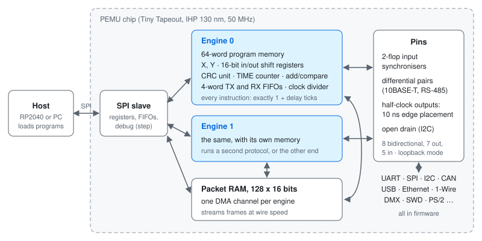
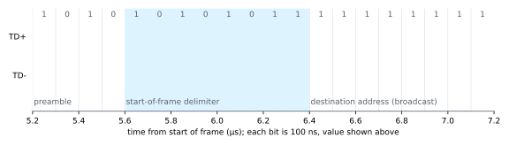
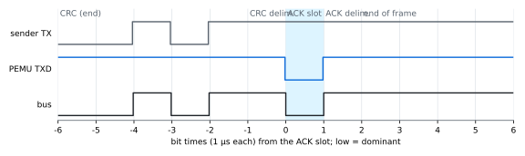
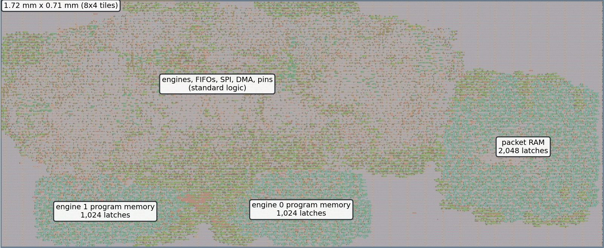

# PEMU: write-up

*Entry for the Jane Street protocol emulator ASIC competition. This page is
the overview: what PEMU is, why it is built this way, how we know it works,
and what it cannot do. Each section links to the detailed document.*

**PEMU is a chip that speaks hardware protocols in firmware.** Two small
engines drive and sample pins with timing that is exact to the clock and
proven formally. UART, I2C, CAN, USB and 10 Mbit/s Ethernet are programs of
2 to 64 instructions, and a new protocol needs no new silicon.

At a glance:

- **21 protocol programs** included, from SPI in 2 instructions to a CAN
  receiver that acknowledges frames in 64. Ethernet takes 31.
- **Beyond protocols:** written after layout sign-off, 640×480 **VGA video**,
  a **music box** that plays a tune from its own memory, and a **MIDI
  synthesizer**. The chip has no video or audio hardware.
- **A playground in the browser** ([playground/index.html](playground/index.html)):
  write programs and watch the pins, with a simulator checked against the
  reference model on every clock.
- **Generality tested blind:** five protocols that played no part in the
  design were added after the hardware was frozen, and fitted.
- **Checked from every side:** a separate reference model compared on every
  clock, formal proofs, 53 chip tests on the RTL and on the routed
  layout with real gate delays, 59 of 59 planted bugs caught, and the same
  design on an FPGA board matching the model register for register.
- **Layout signed off** in an 8x4-tile Tiny Tapeout slot on IHP 130 nm:
  50 MHz at every process corner, about 10 mW.



## 1. The problem

A protocol emulator has to speak whatever wire protocol it is pointed at:
UART today, a sensor's one-off bus tomorrow, Ethernet the day after. Fixed
silicon for each protocol cannot keep up, and a CPU bit-banging pins cannot
meet the timing, because its interrupts and caches make every edge a little
late, by a different amount each time.

PEMU's answer is to make **timing the one thing the hardware guarantees**,
and leave everything else to firmware.

## 2. The design

Two small engines run programs from their own 64-word memories. Every
instruction takes exactly `1 + delay` ticks, with no exceptions, stalls only
where the program asks to wait, and outputs that can move to the falling
clock edge for 10 ns resolution at 50 MHz. That rule is proven formally, not
just tested. Around the engines:

- **Shift registers, side-set and FIFOs**, after the RP2040's PIO, so a
  serial protocol's inner loop is two to four instructions.
- **Wait timeouts with a trap.** `wait 1 pin 1 timeout` jumps to a handler if
  the line never moves. A hung I2C bus, a missing sensor or an idle line is
  handled on the chip, without host polling. (PIO waits forever.)
- **A CRC unit** fed bit by bit, with any polynomial up to 16 bits, so a
  CRC (the SD card's CRC7, CAN's CRC-15) is computed in real time.
- **Edge waits and a timestamp counter**: a logic analyser in four
  instructions.
- **A packet RAM with DMA**, so a whole 10 Mbit/s Ethernet frame streams
  without waiting for the slow host link.
- **Differential outputs and any-edge waits**, which is how 31 instructions
  of firmware speak 10BASE-T Ethernet with no Ethernet hardware on the chip.
- **Compare, add and wait-for-either (v4).** `skip <cond>` cancels the next
  instruction when a condition holds (X < Y, X == Y, FIFO levels, a pin, a
  flag), and the cancelled instruction still takes its tick, so a branch
  costs the same time either way and the timing rule above still holds.
  `mov x, x + src` adds. `wake <cond>` lets a wait end on a second event.

A host (the Tiny Tapeout board's RP2040, or a PC) loads programs and moves
data over SPI. Protocol layers that need arithmetic (Ethernet's CRC-32, ARP,
IP) run on the host; the chip does everything that needs exact timing.

### A program, line by line

This is the complete UART transmitter (`sw/programs/uart_tx.pasm`, with the
comments expanded). One bit lasts 8 ticks, and the clock divider sets the
baud rate.

```
.wrap_target
    pull                    ; wait for a byte from the host (line idles high)
    set pins, 0      [7]    ; start bit: 1 + 7 = 8 ticks
bitloop:
    out pins, 1             ; next data bit onto the pin ...
    jmp x--, bitloop [6]    ; ... held for 1 + 1 + 6 = 8 ticks; X counts 8 bits
    set pins, 1      [5]    ; stop bit: 6 ticks here ...
    set x, 7                ; ... + 1 here + 1 for the pull = 8
.wrap                       ; back to the top, at no cost
```

The `[n]` after an instruction adds `n` ticks. Because every instruction
takes exactly `1 + n` ticks, the bit timing can be read straight off the
source, and the formal proofs guarantee it holds on the chip.
[programming.md](programming.md) teaches the rest.

### Two signals from real firmware

Both pictures are drawn from simulation of the shipped firmware on the
Python model, which the RTL matches on every clock
([make_figures.py](figures/make_figures.py)). Nothing is drawn by hand.

**Ethernet with no Ethernet hardware.** `eth_tx` (16 instructions) drives
the TD+/TD- pair as a differential output. Each 100 ns bit has its mid-bit
transition exactly 50 ns in, placed with the half-clock outputs; here the
preamble ends, the start-of-frame delimiter's closing `11` arrives, and the
broadcast address begins.



**A CAN frame acknowledged by the chip itself.** `can_rx` (64
instructions) follows the frame bit by bit, removes stuff bits, checks the
CRC on the chip and works out where the frame ends from its length field.
When the CRC is right it drives the ACK slot dominant. The sender leaves the
slot recessive and sees the bus go low: the frame is acknowledged.



Details: [README](../README.md) (overview and comparison with PIO and TI's
PRU), [isa.md](isa.md) (the spec), [ethernet.md](ethernet.md).

## 3. Does it generalise? A blind test

The competition is about flexibility, so we tested it directly. We froze the
hardware, then added five protocols that played no part in its design:
1-Wire, NEC infrared remotes, a PS/2 keyboard host, ARM's Serial Wire Debug
and CAN transmit with arbitration. **All five fitted without changing the
hardware.** Four needed only ordinary firmware; CAN transmit fitted, but a
full CAN receiver did not, because it needs counting the engines could not
do.

That test produced a short, specific list of hardware gaps, and v3 and v4
closed all four: more program memory (v3); then compare and add, waiting for
either of two events, and a safe power-up level for the outputs (v4). The
proof is the CAN receiver above: with v4 it fits in exactly 64 instructions.
Details: [new-protocols.md](new-protocols.md).

Every program included, with its size (each engine holds 64 instructions):

| Protocol | Instructions | Protocol | Instructions |
|---|---:|---|---:|
| SPI controller | 2 | 1-Wire | 18 |
| WS2812 LEDs | 4 | DHT22 sensor (v4) | 19 |
| Edge timestamps (logic analyser) | 4 | SPI device (v4) | 19 |
| UART transmit | 6 | NEC infrared | 21 |
| USB low speed, transmit | 8 | CAN transmit, with arbitration | 21 |
| USB low speed, receive (sniffer) | 10 | I2C controller | 27 |
| UART receive | 11 | DMX512 lighting receiver (v4) | 27 |
| ARM Serial Wire Debug | 13 | PS/2 keyboard host | 29 |
| SD card commands + CRC7 | 15 | Rotary encoder (v4) | 37 |
| 10BASE-T Ethernet receive | 15 | CAN receive + acknowledge (v4) | 64 |
| 10BASE-T Ethernet transmit | 16 | | |

Each one runs in the test suite against a model of whatever is on the other
end of the wire (a sensor, a keyboard, a bus, a link partner), written from
that protocol's own rules rather than from PEMU's.

### After sign-off: a picture, a tune and a synthesizer

The v4 layout was finished before these were written, so they are a second
blind test, and a harder one: they are not protocols at all.

**VGA video.** Two programs (50 and 30 instructions) make a 640×480, 60 Hz
picture that any monitor accepts. Engine 0 makes the sync pulses: 1600
clocks per line, 525 lines per frame, every timing written as instruction
delays. Engine 1 draws a 64×32 picture that DMA streams from the packet RAM,
keeping each row in its registers for 15 lines. Flags keep the two engines
in step. This frame came from simulating the chip's Verilog for 1.7 million
clocks and sampling the pins the way a monitor does; it matches the model
pixel for pixel, and every line is exactly 1,600 clocks. The VGA, music and
MIDI tests also pass on the routed layout with real gate delays at all
three process corners.


**A music box.** The packet RAM holds a tune, one word per note. Both
engines' DMA channels stream it: engine 0 (6 instructions) times each note
and raises a flag, and engine 1 (13 instructions) plays it as a square wave
on a speaker pin, in tune to within 2 cents. Once started, the chip plays
the whole of Ode to Joy with no help from the host.

**A MIDI synthesizer.** MIDI is a UART at 31,250 baud, so the existing
`uart_rx` program receives a keyboard unchanged, and the host turns its
note messages into words for a 16-instruction voice, `synth`, that covers
every key of a piano (A0 at 27.5 Hz to C8) in tune to within 7 cents. With
only one engine left for sound, chords are played the way 8-bit game
consoles did: the held notes take turns, 25 ms each, fast enough that the
ear hears a chord.

None of these needed a hardware change. On the Basys 3 board,
`python3 -m pemu.fpga vga`, `music` and `midi` run them
([fpga.md](fpga.md#pictures-music-and-midi)); details in
[new-protocols.md](new-protocols.md#after-sign-off-video-music-and-midi).

## 4. How we know it works

Correctness rests on checks anyone can re-run, not on review.

| Check | What it shows |
|---|---|
| **Lockstep co-simulation** | The RTL and a separate Python model agree on every register, pin and packet RAM word, every clock, over random programs covering the whole instruction encoding (about 700,000 compared clocks per CI run). |
| **Protocol scenarios** | 53 tests run real firmware against device models that enforce each protocol's own timing rules, through the chip's real SPI pins, on the RTL and again on the routed gate-level netlist. |
| **Formal proofs** | Cycle exactness, FIFO safety and ordering, trap behaviour, DMA rules: proven for all inputs (bounded model checking plus induction). |
| **Mutation testing** | 59 realistic bugs planted one at a time; the tests catch all 59. This checks the tests themselves. |
| **Timed gate-level simulation** | All 53 tests also pass on the routed netlist with its real gate delays, at all three process corners, at 50 MHz. This catches races that zero-delay simulation cannot. |
| **Real hardware** | The same v4 RTL on a Basys 3 FPGA board passes the UART, USB and Ethernet self-tests, and matches the Python model register for register over 18,000 single-stepped ticks of random programs. |
| **Layout sign-off** | Tiny Tapeout CI: DRC, LVS, antenna and precheck clean. |

They have caught real mistakes, which is the evidence that they bite:

- **The protocol tests** found that the first SPI interface lost one byte per
  read, because SPI's last clock edge looked like the start of the next
  word. The interface was redesigned so an interrupted read loses nothing.
- **Mutation testing** found that no test compared X and Y when they were
  equal, so a comparison off by one would have passed. A boundary test was
  added.
- **The timed gate-level run** found that the power-up strap was read at the
  same instant reset was released, which only works with zero delays. The
  rule (hold the strap two clocks after reset) is now in the spec.
- **Writing the CAN receiver** showed that the first `skip` took zero time,
  so a branch's timing depended on its condition. It was redesigned to keep
  every path the same length, before any layout was made.

Details: [verification.md](verification.md), and the AI's own mistakes in
[ai-usage.md](ai-usage.md).

## 5. The chip

IHP 130 nm (SG13CMOS5L) through Tiny Tapeout, 8x4 tiles.

| | |
|---|---|
| Logic | 29,128 cells, 0.46 mm², 38% of the area |
| Memory | 4,096 latch bits (two 64-word program memories, a 128-word packet RAM) |
| Speed | 50 MHz at every corner: +2.55 ns slack on typical silicon, +0.48 ns at the worst corner (1.08 V, 125 °C) |
| Power | about 10 mW |



*The routed layout from the Tiny Tapeout CI run. The three teal areas are
the latch memories, placed by the tools where the wiring is shortest.*

The layout was the hardest engineering problem. This process routes signals
on only three metal layers, and the first 8x4 layouts ran out of GitHub's
6-hour limit while still wiring. The router's reports showed the memories'
wiring was the cause. Two redesigns fixed it: each engine got its own
program memory with one read port, and all memories became latch arrays,
half the size of flip-flops. The v4 layout takes 2 h 52 min.
Details: [verification.md, sections 6 and 7](verification.md#6-physical-implementation).

## 6. Limitations

- **Arithmetic is minimal**: add, compare, and the CRC unit. There is no
  multiply, logic operation or shift between registers; firmware builds
  them from add and the shift registers (`mov x, x + x` doubles), and
  anything heavier (CRC-32, IP checksums) runs on the host.
- **Programs are at most 64 instructions.** Jumps are encoded with 6 address
  bits, so a larger memory would not help one program without a new
  instruction format. The CAN receiver uses every word.
- **The CAN receiver** acknowledges standard data frames only, and does not
  send error frames.
- **USB** is low speed only, and the chip sends and sniffs packets but cannot
  answer a USB host within the bus turnaround time, so it does not enumerate
  as a device.
- **Ethernet** is half duplex, with frames up to 124 bytes received and 117
  sent.
- **The worst-corner timing margin is small** (+0.48 ns at 1.08 V, 125 °C).
  For extra safety in hot, low-voltage conditions, use 45 MHz.
- **Not yet tried with outside equipment:** a laptop's Ethernet port, or the
  sensors and transceivers for the newer protocols. The board driver for
  the Tiny Tapeout demo board has run only against the model.

## 7. How it was built

The project owner directed the work and ran the hardware; an AI (Claude,
through Claude Code) wrote the RTL, software, tests and documents. The
account of who did what, how the AI's output was checked, and where it was
wrong is in [ai-usage.md](ai-usage.md).

## 8. Try it

**In a browser:** open [playground/index.html](playground/index.html) (one
self-contained file). Pick an example (serial text, LEDs, the VGA picture,
the music box) or write your own program, press Run, and read the pins,
the decoded output and the registers. The page's simulator is a JavaScript
translation of the Python model, and a test runs both on random programs
and random host traffic and compares every register on every clock.

**The full checks:**

```bash
pip install -r test/requirements.txt    # cocotb, pytest; needs Icarus Verilog
cd sw && python -m pytest -q tests      # model, assembler, firmware
cd ../test && make                      # the 53 chip tests on the RTL
make TB=core                            # RTL against the model, every clock
../formal/run.sh                        # formal proofs (Yosys + Yices)
```

Or run it on a Basys 3 FPGA board, including the tick-by-tick comparison
with the model (`python3 -m pemu.fpga lockstep`): [fpga.md](fpga.md).
